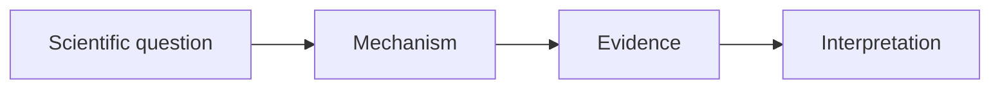

## Motivation

Open with the question the paper addresses, why it is difficult, and who benefits from solving it. This page demonstrates the shared authoring components; it is not a review of one of the six selected papers.



## Background

Introduce only the concepts your explanation needs. For example, the transformer introduces attention as a way to relate elements of a sequence <d-cite key="vaswani2017attention"></d-cite>.

## Core Idea



A compact equation can make a mechanism precise:

$$
\operatorname{Attention}(Q,K,V) = \operatorname{softmax}\left(\frac{QK^\top}{\sqrt{d_k}}\right)V.
$$

Here $Q$, $K$, and $V$ denote queries, keys, and values; $d_k$ is the key dimension. Explain what each operation contributes.

## How It Works


<div class="seminar-diagram" role="img" aria-label="Questions are compared with keys to obtain relevance weights; the weights combine values into contextual information.">
  <div><strong>Queries + keys</strong><span>Compare relevance</span></div><span aria-hidden="true">→</span><div><strong>Weights + values</strong><span>Combine information</span></div><span aria-hidden="true">→</span><div><strong>Context</strong><span>Represent the input</span></div>
</div>



For your own image, use the same component with `src` and `alt`:

```liquid

```

Mermaid is optional and uses the existing chart plugin:



## Results

Describe the experimental comparison and explain its meaning. Name the metric, baseline, and evaluation setting before drawing a conclusion.

| Question                 | Evidence to discuss                |
| ------------------------ | ---------------------------------- |
| Does the mechanism help? | Relevant baseline and ablation     |
| Where does it fail?      | Error analysis and unseen settings |

## Limitations



Use a footnote for a brief aside.<d-footnote>Keep essential reasoning in the main text.</d-footnote>

## Takeaways


